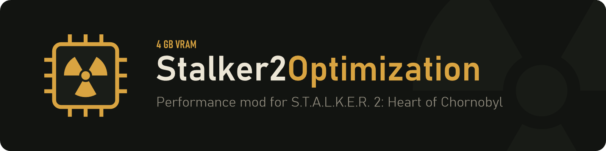

  

  <b>English</b> · <a href="README.ru.md">Русский</a>

# Stalker2Optimization

A performance mod for **S.T.A.L.K.E.R. 2: Heart of Chornobyl** on graphics cards with 4 GB of video memory.

On these cards the game fills video memory after a few minutes in a busy location, and the frame rate drops to 4–12. Loading a save does not help, only restarting the game does, so the game becomes unplayable. The mod removes what takes the most memory and puts limits on the rest. Every other graphics setting is still controlled from the game menu.

The mod makes the game look considerably simpler, but if you own a GPU with 4 GB of video memory, you are used to that. At least you will be able to fully enjoy the story and get a feel for the characters in the dialogue.

### What changes

- **Lumen is off.** Lumen is Unreal Engine 5's global illumination and reflections. It is the heaviest part of the renderer, and on low settings without this mod it also shows noisy white blotches.
- **Video memory under control.** The texture, geometry, frame buffer and shadow pools are capped, and the menu cannot raise them.
- **Sharper textures.** 8x anisotropic filtering and no extra blur, at almost no frame rate cost.
- **Softer sun shadow edges** instead of the stair steps of the low preset.

## Installation

1. Download one file from the [`mod`](mod) folder (open the file and click "Download raw file"):
   - `Stalker2Optimization_P.pak` is the main version.
   - `Stalker2Optimization_ClassicShadows_P.pak` uses classic shadow maps instead of virtual ones. It is a little faster, and shadows may look slightly different.
2. Open the game folder. In Steam: right-click the game → Manage → Browse local files.
3. Go to `Stalker2\Content\Paks`. If there is no `~mods` folder, create it.
4. Put the downloaded file into `~mods`. Install only one version of the mod.
5. Start the game and choose graphics settings. Examples are below.

**Uninstall:** delete the file from `~mods`.

Tested on game version 2.1 on Steam. The GOG and Epic Games Store versions should have the same folder layout, but they were not tested, and neither was the Game Pass version. Do not combine the mod with other optimization mods or Engine.ini tweaks: they change the same settings.

## The trade-off

The mod trades some of the looks for stability. The main loss is Lumen: light no longer bounces off walls and objects. Interiors get darker and more contrasted, soft bounce light disappears, and only screen-space reflections remain. The lighting feels closer to Call of Pripyat with good graphics mods than to a modern Unreal Engine 5 game. Models, textures, fog, vegetation and weather are still STALKER 2's own.

One more concession: textures get 512 MB, so on high settings distant surfaces sometimes load less detailed versions.

## Example: the test machine

Video comparison: the same route without the mod and with it, Medium preset, XeSS at 50%.

| | |
| --- | --- |
| Graphics card | GeForce GTX 1650 Super, 4 GB |
| CPU | Intel Core i5-9400F |
| RAM | 32 GB |
| Storage | NVMe SSD |
| Monitor | 1920×1080, 60 Hz |

**Recommended settings:** Medium preset, XeSS upscaling at Ultra Quality (66%).

Frame rate in Pripyat, around and inside the hub:

| Settings | Without the mod | With the mod |
| --- | --- | --- |
| Low, TSR 100% (renders at 1080p) | 20–25, drops to 4–5 after 1–2 minutes | 40–50, no drop |
| Medium, XeSS Ultra Quality Plus (76%) | 30–40, drops to 10–12 after 1–2 minutes | 48–55 |
| Medium, XeSS Ultra Quality (66%) | 40–50, drops to 10–12 after 2–3 minutes | 60–70 |

In crowded places the CPU (Intel Core i5-9400F) runs at 90–100%, and from there it is the CPU that limits the frame rate. This does not cause drops.

GTX 1060 3 GB owners and similar can try the mod too, but that GPU has less memory, so start with the settings from the next section.

## If you just need the game to run

For the weakest graphics cards:

- Low graphics preset
- XeSS upscaling at Ultra Performance (33%)
- the mod installed

Technically, the game renders at 640×360 and upscales to 1080p. In practice the image is softer and thin distant objects may disappear, but the load on the graphics card and its memory is minimal, and the textures still look acceptable (closer to Call of Pripyat with good graphics mods). The mod was not tested on such hardware, so treat this as a starting point, not a guarantee.

## Known issues

- The game occasionally crashes with `EXCEPTION_ACCESS_VIOLATION`. Such crashes also happen without mods, and no link to this mod was found.
- At low upscaling scales (around 50% and below) thin objects such as wires or a fence seen through a scope may vanish, and light streaks sometimes flicker along the bottom edge of the screen while running. These are upscaler limits at low resolution, and a higher scale helps.

The mod's settings are in the [`src`](src) folder as a plain text file.

License: [MIT](LICENSE).
