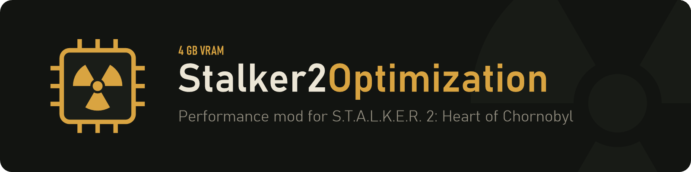

  

  <a href="README.md">English</a> · <b>Русский</b>

# Stalker2Optimization

Мод на производительность для **S.T.A.L.K.E.R. 2: Heart of Chornobyl** на видеокартах с 4 ГБ видеопамяти.

На таких картах игра через несколько минут в населённой локации заполняет видеопамять, и частота кадров падает до 4–12. Загрузка сохранения не помогает — только перезапуск игры, поэтому играть становится невозможно. Мод убирает то, что занимает больше всего памяти, и ставит лимиты на остальное. Все прочие настройки графики по-прежнему меняются в меню игры.

Предоставляемое решение сделает графику игры значительно проще, но если Вы владелец GPU с 4 ГБ видеопамяти — Вам не привыкать. По крайней мере, Вы сможете в полной мере насладиться нарративной составляющей и прочувствовать характер персонажей в диалогах.

### Что меняется

- **Выключен Lumen** — глобальное освещение и отражения Unreal Engine 5. Это самая тяжёлая часть графики, а на низких настройках без этого мода она ещё и шумит белыми пятнами.
- **Видеопамять под контролем.** Ограничены пулы текстур, геометрии, буферов кадра и теней, и меню не может их поднять.
- **Резче текстуры.** Анизотропная фильтрация 8x и без лишнего размытия — по кадрам почти бесплатно.
- **Мягче края теней** от солнца вместо «ступенек» низких настроек.

## Установка

1. Скачайте один файл из папки [`mod`](mod) — откройте файл и нажмите «Download raw file»:
   - `Stalker2Optimization_P.pak` — основной вариант;
   - `Stalker2Optimization_ClassicShadows_P.pak` — с классическими тенями вместо виртуальных: немного быстрее, тени могут выглядеть чуть иначе.
2. Откройте папку игры. В Steam: правой кнопкой по игре → «Управление» → «Просмотреть локальные файлы».
3. Перейдите в `Stalker2\Content\Paks`. Если там нет папки `~mods`, создайте её.
4. Положите скачанный файл в `~mods`. Ставьте только один вариант мода.
5. Запустите игру и выберите настройки графики — примеры ниже.

**Удаление:** удалите файл из папки `~mods`.

Мод проверен на версии игры 2.1 в Steam. В GOG и Epic Games Store структура папок должна быть такой же, но там, как и в версии из Game Pass, он не проверялся. Не совмещайте его с другими модами на оптимизацию и твиками Engine.ini: они меняют те же параметры.

## Компромисс

Мод меняет часть красоты на стабильность. Главная потеря — Lumen: свет больше не отражается от стен и предметов. В помещениях становится темнее и контрастнее, пропадают мягкие отсветы, отражения остаются только экранные. По характеру освещения картинка ближе к «Зову Припяти» с хорошими графическими модами, чем к современной игре на Unreal Engine 5. Модели, текстуры, туман, растительность и погода при этом остаются из STALKER 2.

Ещё одна уступка: текстурам отведено 512 МБ, поэтому на высоких настройках вдали иногда подгружаются менее детальные версии.

## Пример: на чём проверялось

| | |
| --- | --- |
| Видеокарта | GeForce GTX 1650 Super, 4 ГБ |
| Процессор | Intel Core i5-9400F |
| Память | 32 ГБ |
| Диск | NVMe SSD |
| Монитор | 1920×1080, 60 Гц |

**Рекомендуемые настройки:** пресет «Средние», масштабирование XeSS «Ультракачество» (66 %).

Кадры в Припяти, у хаба и внутри него:

| Настройки | Без мода | С модом |
| --- | --- | --- |
| «Низкие», TSR 100 % (рендер в 1080p) | 20–25, через 1–2 минуты обвал до 4–5 | 40–50, без обвала |
| «Средние», XeSS «Ультракачество плюс» (76 %) | 30–40, через 1–2 минуты обвал до 10–12 | 48–55 |
| «Средние», XeSS «Ультракачество» (66 %) | 40–50, через 2–3 минуты обвал до 10–12 | 60–70 |

В людных местах процессор (Intel Core i5-9400F) загружен на 90–100 %, и дальше кадры упираются уже в него — это не приводит к просадкам.

Владельцы GTX 1060 3 ГБ и похожих карт тоже могут попробовать, но памяти у этой GPU меньше — начинайте с настроек из следующего раздела.

## Если нужно, чтобы игра просто запустилась

Для самых слабых видеокарт:

- пресет графики «Низкие»;
- масштабирование XeSS «Ультрапроизводительность» (33 %);
- установленный мод.

Технически игра будет рисовать кадр в 640×360 и растягивать его до 1080p. Фактически — картинка мягче, тонкие предметы вдали могут пропадать, зато нагрузка на видеокарту и память минимальна, а сами текстуры выглядят удовлетворительно (ближе к «Зову Припяти» с хорошими графическими модами). На таком железе мод не тестировался, так что это отправная точка, а не гарантия.

## Известные проблемы

- Игра изредка вылетает с ошибкой `EXCEPTION_ACCESS_VIOLATION`. Такие вылеты бывают и без модов, связи с этим модом найти не удалось.
- На низком масштабе (около 50 % и ниже) тонкие объекты — провода, сетка забора в прицеле — могут пропадать, а у нижнего края экрана при беге иногда мелькают светлые полосы. Это особенности апскейлера на низком разрешении, помогает масштаб повыше.

Настройки мода лежат в папке [`src`](src) в виде обычного текстового файла.

Лицензия: [MIT](LICENSE).
